ParkPing: Order Processing, Inventory Management & Warehouse Fulfillment Architecture (v3: Pick-to-Scan)
This architectural blueprint integrates the core e-commerce, commercial inventory, serialized tracking, payment, and warehouse logistics systems with 6 foundational lifecycle principles:

1. Four-Tier Inventory Separation:
   - Commercial Inventory: SKU-level quantities reserved during checkout and committed upon payment.
   - Serialized Inventory: Uniquely numbered physical QR tags tracked by permanent ID; no customer-order assignment at checkout.
   - Warehouse Fulfillment: Physical tags scanned and bound to an order item during warehouse packing (Pick-to-Scan).
   - Shipping: Allowed only after the packing manifest is verified, complete, and finalized.
2. Reserve-Before-Payment, Commit-After-Payment (Quantity-Level): Strict sequencing with race-free payment reconciliation. Specific QR tags are never pre-assigned to carts or orders prior to packing.
3. Decoupled Operational vs. Inventory State: `QrTag.status` handles customer vehicle pairing; `QrTagInventory.state` handles physical commerce stock states (`IN_STOCK`, `ALLOCATED_TO_ORDER`, `DISPATCHED`, `DELIVERED`).
4. Dual Tracking (Audit vs Authority): `PackingScan` serves as the immutable audit log of packing attempts; `OrderTagAllocation` serves as the globally unique, authoritative relation between an order and a serialized tag.
5. Purchase-to-Tag Fulfillment Traceability: Record which serialized tags were allocated to and shipped with an order for inventory and support auditing; this mapping does not authorize pairing or transfer subscription benefits.
6. Account-Level Purchase-Driven, Pairing-Activated Subscriptions: A qualifying purchase creates an account-level PLUS grant. Tag possession alone never grants PLUS.

1. End-to-End Architecture Flow

```mermaid
flowchart TD
    subgraph 1. Online Checkout & Commercial Reservation
        A[Customer Selects Bundle / Pack] --> B[Validate Live Price & SKU Quantity Availability]
        B --> C{Sufficient SKU Quantities?}
        C -->|No| D[Reject / Out of Stock Toast]
        C -->|Yes| E[Create Atomic SKU Quantity Reservation, TTL 15 min]
        E --> F[Create Guest-Capable Order Linked to Reservation]
        F --> G[Create Razorpay Order synchronously]
        G --> H[Customer opens Razorpay Checkout]
    end

    subgraph 2. Payment Reconciliation
        H --> I[Customer completes payment]
        I --> J[Razorpay Webhook: verify raw-body signature]
        J --> K[Persist WebhookInbox & ACK 200 promptly]
        K --> L[Inbox Worker reconciles payment idempotently]
        L --> M{Captured payment valid?}
        M -->|No / Failed| N[Record failure / policy resolution]
        M -->|Yes| O[Atomically commit order status: PAID, commit SKU quantities, create PLUS grant]
    end

    subgraph 3. Warehouse Pick-to-Scan Packing
        O --> P[Warehouse Packer opens Order in Admin]
        P --> Q[Start PackingSession: Order status PACKING]
        Q --> R[Packer picks any matching physical tags from bin]
        R --> S[Packer scans physical QR codes with barcode/camera]
        S --> T{Atomic Scan Verification:<br/>1. Tag exists & belongs to required SKU?<br/>2. Tag state is IN_STOCK & UNASSIGNED?<br/>3. Not duplicate in session or allocated globally?}
        T -->|No| U[Reject Scan / Audible Warning]
        T -->|Yes| V[Atomic: Write PackingScan audit + OrderTagAllocation + QrTagInventory state ALLOCATED_TO_ORDER]
        V --> W{All required items & quantities scanned?}
        W -->|No| R
        W -->|Yes| X[Finalize Manifest: PackingSession COMPLETED, Order status PACKED]
    end

    subgraph 4. Shipping & Logistics
        X --> Y[Outbox Job: Create Shiprocket Order & Generate AWB/Label]
        Y --> Z[Order status SHIPPED: Track via Shiprocket Webhooks]
    end

    subgraph 5. Customer Pairing & PLUS Activation
        Z --> AA[Customer Receives Physical Package]
        AA --> BB[Customer scans tag to pair to vehicle]
        BB --> CC[Validate Tag status UNASSIGNED & resource ownership]
        CC --> DD[Pair Tag to Vehicle]
        DD --> EE[Subscription Module checks User Account for PLUS Grant]
        EE --> FF{Unredeemed PLUS Grant Exists?}
        FF -->|Yes| GG[Activate PLUS 12 Months Idempotently]
        FF -->|No| HH[Tag pairs under BASIC tier]
    end
```

2. Refined Domain Models (Prisma Schema)
A. Catalog & Product Configurator (BOM)
enum ProductType {
  PHYSICAL_TAG_PACK
  SUBSCRIPTION_ONLY
  MERCHANDISE
}

enum ComponentType {
  SERIALIZED_QR_TAG   // Requires allocating specific pre-printed QrTags
  PHYSICAL_ITEM       // Tracked by SKU count (mounts, packaging, keychains)
  DIGITAL_ENTITLEMENT // Plus subscription, lifetime features
}

model Product {
  id          String      @id @default(uuid()) @db.Uuid
  sku         String      @unique
  name        String
  slug        String      @unique
  description String?
  type        ProductType @default(PHYSICAL_TAG_PACK)
  active      Boolean     @default(true)
  basePrice   Int         // In paise (e.g., 49900 = ₹499)
  currency    String      @default("INR")

  weightGrams Int         @default(100)
  lengthCm    Float       @default(15.0)
  breadthCm   Float       @default(10.0)
  heightCm    Float       @default(2.0)

  variants    ProductVariant[]
  createdAt   DateTime    @default(now())
  updatedAt   DateTime    @updatedAt
}

model ProductVariant {
  id             String             @id @default(uuid()) @db.Uuid
  productId      String             @db.Uuid
  sku            String             @unique
  name           String             // e.g. "Pack of 4 - Standard Matte"
  price          Int                // In paise
  active         Boolean            @default(true)

  product        Product            @relation(fields: [productId], references: [id], onDelete: Cascade)
  components     ProductComponent[]
  orderItems     OrderItem[]
  reservationItems ReservationItem[]

  createdAt      DateTime           @default(now())
  updatedAt      DateTime           @updatedAt

  @@index([productId])
}

model ProductComponent {
  id                 String         @id @default(uuid()) @db.Uuid
  variantId          String         @db.Uuid
  componentType      ComponentType
  name               String         // e.g. "Preprinted Vehicle QR Tag" or "12-Month Plus Plan"
  quantity           Int            @default(1)
  
  // For DIGITAL_ENTITLEMENT (e.g. 12 months)
  plusDurationMonths Int            @default(0)
  
  // For PHYSICAL_ITEM reference
  inventorySku       String? // Required for SERIALIZED_QR_TAG and PHYSICAL_ITEM; identifies the exact stock type/SKU
  reservedTags       ReservedTag[]

  variant            ProductVariant @relation(fields: [variantId], references: [id], onDelete: Cascade)

  @@index([variantId])
}
B. Inventory & The Reservation Lifecycle (Change 1 & 3)
Separates Operational state (QrTag.status: UNASSIGNED, ASSIGNED, SUSPENDED, REVOKED) from Inventory & Reservation states.
enum ReservationStatus {
  ACTIVE       // In checkout TTL (15-20 min)
  COMMITTED    // Payment confirmed; stock converted to actual order
  RELEASED     // Checkout cancelled or abandoned
  EXPIRED      // TTL elapsed without payment
}

// Master reservation record created prior to Order creation
model InventoryReservation {
  id               String            @id @default(uuid()) @db.Uuid
  checkoutSessionId String           @unique // Stable server-generated guest checkout identifier
  userId           String?           @db.Uuid // Optional: checkout does not require an account
  status           ReservationStatus @default(ACTIVE)
  expiresAt    DateTime          // now() + 15 minutes
  releasedAt   DateTime?
  committedAt  DateTime?

  items        ReservationItem[]
  order        Order?
  reservedTagInventory QrTagInventory[]

  createdAt    DateTime          @default(now())
  updatedAt    DateTime          @updatedAt

  user         User?             @relation(fields: [userId], references: [id], onDelete: Restrict)

  @@index([userId, status])
  @@index([status, expiresAt])
}

// Represents reserved variant lines
model ReservationItem {
  id             String               @id @default(uuid()) @db.Uuid
  reservationId  String               @db.Uuid
  variantId      String               @db.Uuid
  quantity       Int                  @default(1)

  reservation    InventoryReservation @relation(fields: [reservationId], references: [id], onDelete: Cascade)
  variant        ProductVariant       @relation(fields: [variantId], references: [id], onDelete: Restrict)
  allocatedTags  ReservedTag[]

  @@index([reservationId])
}

// Historical link between a reservation line and the exact QR tag selected.
// Do not rely on this history table alone as the current availability source.
model ReservedTag {
  id                String          @id @default(uuid()) @db.Uuid
  reservationItemId String          @db.Uuid
  componentId       String          @db.Uuid // Identifies the exact serialized tag component/SKU
  qrTagId           String          @db.Uuid

  reservationItem   ReservationItem @relation(fields: [reservationItemId], references: [id], onDelete: Cascade)
  component         ProductComponent @relation(fields: [componentId], references: [id], onDelete: Restrict)
  qrTag             QrTag           @relation(fields: [qrTagId], references: [id], onDelete: Restrict)

  @@index([qrTagId])
}

enum QrTagStockState {
  IN_STOCK
  RESERVED
  ALLOCATED_TO_ORDER
  DISPATCHED
  DELIVERED
  DAMAGED
  RETURNED_TO_STOCK
}

// Current commerce state for each serialized tag; distinct from QrTag.status.
// Keep reservation/allocation history in the reservation and order tables.
model QrTagInventory {
  id                    String          @id @default(uuid()) @db.Uuid
  qrTagId               String          @unique @db.Uuid
  sku                   String // Stock type/variant for this physical tag; used to reserve the correct tag type
  state                 QrTagStockState @default(IN_STOCK)
  activeReservationId   String?         @db.Uuid
  updatedAt             DateTime        @updatedAt

  qrTag                 QrTag           @relation(fields: [qrTagId], references: [id], onDelete: Restrict)
  activeReservation     InventoryReservation? @relation(fields: [activeReservationId], references: [id], onDelete: Restrict)

  @@index([sku, state])
  @@index([state, activeReservationId])
}

// Non-serialized inventory stock (keychains, stickers, packaging boxes)
model InventoryStock {
  id             String   @id @default(uuid()) @db.Uuid
  sku            String   @unique
  name           String
  quantityOnHand Int      @default(0)
  reservedCount  Int      @default(0) // Locked in ACTIVE reservations
  reorderLevel   Int      @default(50)
  updatedAt      DateTime @updatedAt
}

C. Order, Payment & Durable Tag Entitlements (Change 4 & 5)
enum OrderStatus {
  PAYMENT_PENDING
  PAID
  PACKING
  PACKED
  SHIPPED
  DELIVERED
  CANCELLED
  REFUNDED
}

enum PackingSessionStatus {
  IN_PROGRESS
  COMPLETED
  CANCELLED
}

enum GrantStatus {
  PENDING_CLAIM   // Guest purchase has not yet been claimed into an account
  PENDING_PAIRING // Claimed by an account; waiting for first eligible pairing
  ACTIVATED       // PLUS grant has been redeemed
  REVOKED         // Refunded/reversed under the applicable policy
}

model Order {
  id                 String           @id @default(uuid()) @db.Uuid
  orderNumber        String           @unique // e.g. "PK-ORD-2026-1001"
  userId             String?          @db.Uuid // Nullable for guest checkout; populated only after explicit verified claim
  customerEmail      String?
  customerPhone      String?
  reservationId      String           @unique @db.Uuid
  razorpayOrderId    String?          @unique // Set after server-side Razorpay order creation succeeds
  checkoutIdempotencyKey String?      @unique // Client-supplied idempotency token, scoped/validated server-side

  status             OrderStatus      @default(PAYMENT_PENDING)
  subtotalAmount     Int              // In paise
  taxAmount          Int              @default(0)
  shippingAmount     Int              @default(0)
  totalAmount        Int              // In paise

  reservation        InventoryReservation @relation(fields: [reservationId], references: [id], onDelete: Restrict)
  shippingAddress    ShippingAddress?
  items              OrderItem[]
  payments           PaymentTransaction[]
  shipments          Shipment[]
  packingSessions    PackingSession[]     // Historical & active packing attempts
  tagAllocations     OrderTagAllocation[] // Authoritative mapping: tag <-> order
  subscriptionGrants SubscriptionGrant[]
  purchaseClaim      PurchaseClaim?

  createdAt          DateTime         @default(now())
  updatedAt          DateTime         @updatedAt
  user               User?            @relation(fields: [userId], references: [id], onDelete: Restrict)

  @@index([userId, status])
}

// Authoritative mapping: which physical tags are allocated to this order.
// Enforces global uniqueness: qrTagId @unique prevents double-allocation across all orders.
model OrderTagAllocation {
  id        String   @id @default(uuid()) @db.Uuid
  orderId   String   @db.Uuid
  qrTagId   String   @unique @db.Uuid // Globally unique: a tag can belong to at most ONE order
  createdAt DateTime @default(now())

  order     Order    @relation(fields: [orderId], references: [id], onDelete: Restrict)
  qrTag     QrTag    @relation(fields: [qrTagId], references: [id], onDelete: Restrict)

  @@index([orderId])
}

// Warehouse Pick-to-Scan Packing Sessions
// Multi-attempt support: sessionNumber allows restarting cancelled packing sessions without violating uniqueness.
model PackingSession {
  id            String               @id @default(uuid()) @db.Uuid
  orderId       String               @db.Uuid
  sessionNumber Int                  @default(1)
  packedBy      String?              // Admin / Warehouse worker ID or name
  status        PackingSessionStatus @default(IN_PROGRESS)
  startedAt     DateTime             @default(now())
  completedAt   DateTime?

  order         Order                @relation(fields: [orderId], references: [id], onDelete: Cascade)
  scans         PackingScan[]

  createdAt     DateTime             @default(now())
  updatedAt     DateTime             @updatedAt

  @@unique([orderId, sessionNumber]) // Multiple attempts per order supported
  @@index([orderId, status])
}

// Immutable audit log of every scan event in a packing session.
// Note: PackingScan is an audit trail, while OrderTagAllocation is the authoritative domain record.
model PackingScan {
  id               String         @id @default(uuid()) @db.Uuid
  packingSessionId String         @db.Uuid
  orderItemId      String         @db.Uuid
  qrTagId          String         @db.Uuid
  scannedTagNumber String
  scannedAt        DateTime       @default(now())

  packingSession   PackingSession @relation(fields: [packingSessionId], references: [id], onDelete: Cascade)
  orderItem        OrderItem      @relation(fields: [orderItemId], references: [id], onDelete: Restrict)
  qrTag            QrTag          @relation(fields: [qrTagId], references: [id], onDelete: Restrict)

  @@unique([packingSessionId, qrTagId]) // Cannot scan same tag twice in the same session
  @@index([orderItemId])
}

// A guest order's purchase grant is initially unclaimed. Claiming attaches it to an account.
// Assumption for v2: at most one PLUS grant per order; aggregate bundle inclusions accordingly.
model SubscriptionGrant {
  id                 String      @id @default(uuid()) @db.Uuid
  userId             String?     @db.Uuid // Null until verified purchase claim
  orderId            String      @db.Uuid
  grantKey           String      @unique // Stable idempotency key derived server-side
  plusDurationMonths Int         @default(12)
  status             GrantStatus @default(PENDING_CLAIM)

  createdAt          DateTime    @default(now()) // Grant eligibility begins at this point
  activatedAt        DateTime?
  triggeringQrTagId  String?     @db.Uuid // Audit detail only; does not tie grant to this tag's order

  order              Order       @relation(fields: [orderId], references: [id], onDelete: Restrict)
  user               User?       @relation(fields: [userId], references: [id], onDelete: Restrict)

  @@unique([orderId])
  @@index([userId, status])
}

model PurchaseClaim {
  id                 String   @id @default(uuid()) @db.Uuid
  orderId            String   @unique @db.Uuid
  userId             String   @db.Uuid
  verificationMethod String
  verifiedAt         DateTime
  claimedAt          DateTime @default(now())

  order              Order    @relation(fields: [orderId], references: [id], onDelete: Restrict)
  user               User     @relation(fields: [userId], references: [id], onDelete: Restrict)

  @@index([userId, claimedAt])
}
D. Payment Webhook, Inbox, Outbox & External Provider Records (required for Step 3)
The following are design-level Prisma sketches, not a drop-in migration. Merge their fields and reverse relations into the existing schema and validate with the project's installed Prisma version before migrating.
enum PaymentStatus {
  CREATED
  AUTHORIZED
  CAPTURED
  FAILED
  REFUND_PENDING
  REFUNDED
  RECONCILIATION_REQUIRED
}

enum WebhookProcessingStatus {
  RECEIVED
  PROCESSING
  PROCESSED
  RETRY
  DEAD_LETTER
}

enum OutboxStatus {
  PENDING
  PROCESSING
  COMPLETED
  RETRY
  DEAD_LETTER
}

model PaymentTransaction {
  id                    String        @id @default(uuid()) @db.Uuid
  orderId               String        @db.Uuid
  provider              String        @default("RAZORPAY")
  providerOrderId       String
  providerPaymentId     String?       @unique
  status                PaymentStatus @default(CREATED)
  amount                Int           // paise; snapshot expected for this payment/order
  currency              String        @default("INR")
  capturedAt            DateTime?
  failureCode           String?
  failureDescription    String?
  createdAt             DateTime      @default(now())
  updatedAt             DateTime      @updatedAt
  order                 Order         @relation(fields: [orderId], references: [id], onDelete: Restrict)

  @@index([orderId, status])
  @@index([providerOrderId])
}

model WebhookInbox {
  id                    String                 @id @default(uuid()) @db.Uuid
  provider              String                 @default("RAZORPAY")
  eventId               String                 // x-razorpay-event-id
  eventType             String
  payload               Json                   // store only after signature verification
  status                WebhookProcessingStatus @default(RECEIVED)
  receivedAt            DateTime               @default(now())
  processedAt           DateTime?
  attempts              Int                    @default(0)
  nextAttemptAt         DateTime?
  lastError             String?

  @@unique([provider, eventId])
  @@index([status, nextAttemptAt, receivedAt])
}

model OutboxJob {
  id                    String       @id @default(uuid()) @db.Uuid
  type                  String       // e.g. PAYMENT_RECONCILE, FULFILL_ORDER, REQUEST_REFUND
  dedupeKey             String       @unique
  payload               Json
  status                OutboxStatus @default(PENDING)
  attempts              Int          @default(0)
  availableAt           DateTime     @default(now())
  lockedAt              DateTime?
  lockedBy              String?
  completedAt           DateTime?
  lastError             String?
  createdAt             DateTime     @default(now())
  updatedAt             DateTime     @updatedAt

  @@index([status, availableAt])
}
Model notes:
- providerOrderId is repeated across payment attempts only if your data model intentionally allows it; use a unique Order.razorpayOrderId for the single Razorpay order created for a local order, or model explicit checkout attempts if replacement Razorpay orders are possible. Do not accidentally enforce uniqueness on a field that is expected to repeat.
- Store the webhook event ID from x-razorpay-event-id, not a guessed ID derived from payload fields. Keep unique event deduplication separate from payment-level idempotency (providerPaymentId and guarded order transitions).
- A WebhookInbox row is inserted only after raw-body signature verification succeeds. Keep invalid-signature requests out of the trusted inbox; log security metadata safely without storing secrets.
- Store the verified event payload as JSON for diagnosis and reprocessing, but use the raw request bytes for signature verification. Do not attempt to recreate the signed body by serializing parsed JSON.
- An outbox job is committed in the same PostgreSQL transaction as the state change that requires it. A worker polls/claims jobs with row locks and retryable state transitions. If using BullMQ/Redis, publish from the outbox and retain the outbox as the durable source of truth; a database commit followed by a direct Redis enqueue is a dual-write failure window.
- Consider separate tables for refund attempts and Shiprocket API attempts if their retry/audit requirements grow; do not represent an unconfirmed refund as REFUNDED.
E. Required payment state and webhook rules
1. Checkout request is synchronous only until Razorpay order creation. Create the local order and immutable order snapshots first, commit that transaction, then call Razorpay's Orders API with server-calculated amount (paise), currency: "INR", a unique receipt/order reference (within Razorpay's receipt limits), and minimal internal metadata. Save the returned Razorpay order ID. If the API call times out, reconcile the uncertain result before blindly creating another Razorpay order. The browser receives the public key ID, Razorpay order ID, amount, and currency; never return the key secret.
2. The customer payment is not part of the checkout HTTP request. The browser opens Razorpay Checkout and can display its callback result. Browser success is useful for user experience, but it is not the sole fulfillment authority. Send the callback identifiers/signature to a server endpoint for checkout-signature verification and/or fetch provider status when immediate confirmation is required. Webhooks remain the primary asynchronous automation signal.
3. Webhook endpoint: register a public HTTPS endpoint such as POST /api/webhooks/razorpay. Ensure the raw-body parser/middleware is mounted for this route before JSON parsing; verify X-Razorpay-Signature with HMAC-SHA256 using the configured webhook secret and the exact raw request bytes. This secret is distinct from the API key secret. Support secret rotation by retaining the old webhook secret for validation of retried older events as required.
4. Subscribe to events: at minimum configure payment.captured and payment.failed; optionally payment.authorized for visibility, but authorization alone must not fulfill an order. order.paid can also be subscribed to, but avoid performing fulfillment twice when both payment.captured and order.paid arrive. Choose one canonical captured-payment processing path and make all other events update/reconcile state idempotently. Razorpay documents that webhook payloads are event-time snapshots, deliveries may be duplicated or out of order, and a payment.failed event can precede a later successful capture for the same user payment flow.
5. Persist before acknowledge: after signature verification, insert WebhookInbox with provider + x-razorpay-event-id under a unique constraint. Commit it before returning 2xx. A duplicate event ID should be acknowledged without reprocessing once the prior record is durably stored. Keep the handler short; do not call Shiprocket, send email/SMS, or wait for a fulfillment job inside the webhook request. Return non-2xx if the event could not be durably persisted so provider retry can occur. Respect Razorpay's webhook response deadline and retry policy; alert if delivery failures disable the webhook.
6. Inbox processing: a worker claims unprocessed inbox records using a database-safe claim/lease strategy, then validates event type and payload shape. Resolve the local order through the stored Razorpay order ID, not untrusted browser-supplied order numbers. Verify payment ID, associated Razorpay order ID, amount, currency, and captured state. If the payload is ambiguous or mismatched, mark it for reconciliation/manual review; do not fulfill it.
7. Payment idempotency: deduplicating eventId alone is insufficient because different events can describe the same payment. Enforce unique provider payment IDs where available and guard state transitions with conditional updates/transactions. A payment.failed event must not downgrade an order already confirmed paid or prevent a later capture. Duplicate captured events must not decrement inventory, create a grant, or enqueue fulfillment twice.
8. Atomic successful reconciliation: in one PostgreSQL transaction, lock or conditionally transition the order and reservation; validate the amount/currency and expected Razorpay IDs; secure the entire bundle; mark the payment captured and order paid; commit the reservation; transition serialized inventory to ALLOCATED_TO_ORDER; decrement bulk on-hand and reserved counters exactly once; create OrderTagAllocation rows exactly once; create a qualifying SubscriptionGrant exactly once; and insert a uniquely keyed fulfillment/outbox job. If any invariant fails, do not mark the order as successfully fulfilled—persist a reconciliation case for a real captured payment.
9. Worker retries: use bounded exponential backoff with jitter for transient failures. Store attempt count, last error and next retry time. Mark unrecoverable or exhausted jobs DEAD_LETTER/manual-review; provide a way to replay after correction. A worker crash must leave a job claimable after its lease expires. Make every job idempotent using a stable dedupeKey and database constraints.
10. Order status is not payment-attempt status. A failed attempt can be followed by another attempt. Track individual payment transactions separately. Only close the checkout and release the reservation when the order's retry/expiry policy says it is closed, and ensure expiry and payment reconciliation serialize on the same reservation/order rows.
11. Reconciliation backstop: periodically find orders stuck in PAYMENT_PENDING, inbox events stuck in PROCESSING, and outbox jobs past retry time. For uncertain payments, query Razorpay's Orders/Payments API and reconcile provider state; do not infer a payment failure solely from a missing webhook or browser disconnect.
Official references to verify during implementation:
- Razorpay Create Order API: https://razorpay.com/docs/api/orders/create/
- Razorpay Webhooks: https://razorpay.com/docs/webhooks/
- Razorpay webhook signature validation and event handling: https://razorpay.com/docs/webhooks/validate-test/
3. Transaction Boundaries & Allocation Engine (Change 1 & 2)
A. Atomic Bundle Reservation Algorithm
When a user initiates checkout, the reservation must be all-or-nothing:
async function createAtomicReservation(
  checkoutSessionId: string,
  userId: string | null, // Guest checkout is supported
  variantId: string,
  quantity: number
): Promise<InventoryReservation> {
  const TTL_MINUTES = 15;
  const expiresAt = new Date(Date.now() + TTL_MINUTES * 60 * 1000);

  return await prisma.$transaction(async (tx) => {
    // 1. Fetch variant Bill of Materials
    const variant = await tx.productVariant.findUniqueOrThrow({
      where: { id: variantId, active: true },
      include: { components: true },
    });

    // 2. Calculate component requirements. Different tag types/SKUs must not be pooled
    // into one generic count; aggregate repeated components by SKU to avoid selecting the
    // same tag twice when a BOM contains multiple components with the same SKU.
    const physicalItemDeltas = new Map<string, number>();
    const serializedRequirements = new Map<string, Array<{ componentId: string; needed: number }>>();
    const selectedTags: Array<{ id: string; tagNumber: string; componentId: string }> = [];

    for (const comp of variant.components) {
      if (comp.quantity <= 0) throw new Error(`Invalid component quantity for ${comp.id}`);
      if (comp.componentType === "SERIALIZED_QR_TAG") {
        if (!comp.inventorySku) throw new Error(`Serialized tag component ${comp.id} must define inventorySku`);
        const requirements = serializedRequirements.get(comp.inventorySku) || [];
        requirements.push({ componentId: comp.id, needed: comp.quantity * quantity });
        serializedRequirements.set(comp.inventorySku, requirements);
      } else if (comp.componentType === "PHYSICAL_ITEM") {
        if (!comp.inventorySku) throw new Error(`Physical component ${comp.id} must define inventorySku`);
        const current = physicalItemDeltas.get(comp.inventorySku) || 0;
        physicalItemDeltas.set(comp.inventorySku, current + comp.quantity * quantity);
      }
    }

    // 3. Atomically select the exact serialized tag SKU quantities.
    for (const [sku, requirements] of [...serializedRequirements.entries()].sort(([a], [b]) => a.localeCompare(b))) {
      const needed = requirements.reduce((sum, item) => sum + item.needed, 0);
      const tagsForSku = await tx.$queryRaw<Array<{ id: string; tagNumber: string }>>`
        SELECT q.id, q."tagNumber"
        FROM "QrTag" q
        JOIN "QrTagInventory" qi ON qi."qrTagId" = q.id
        WHERE q.status = 'UNASSIGNED'
          AND q.origin = 'PREPRINTED_INVENTORY'
          AND qi.sku = ${sku}
          AND qi.state = 'IN_STOCK'
        ORDER BY q."createdAt" ASC
        LIMIT ${needed}
        FOR UPDATE OF q SKIP LOCKED;
      `;
      if (tagsForSku.length < needed) {
        throw new BadRequestError(`Insufficient QR tag stock for SKU ${sku}`);
      }

      let offset = 0;
      for (const requirement of requirements) {
        const componentTags = tagsForSku.slice(offset, offset + requirement.needed);
        selectedTags.push(...componentTags.map((tag) => ({ ...tag, componentId: requirement.componentId })));
        offset += requirement.needed;
      }
    }

    // Locking the QrTag rows above serializes competing selections; changing QrTagInventory
    // state below makes availability explicit. Verify all state changes succeed before commit.

    // 4. Reserve bulk stock with a conditional atomic update. A read-then-increment
    // without a row lock/condition can oversell when two checkouts race.
    for (const [sku, count] of [...physicalItemDeltas.entries()].sort(([a], [b]) => a.localeCompare(b))) {
      const updated = await tx.$executeRaw`
        UPDATE "InventoryStock"
        SET "reservedCount" = "reservedCount" + ${count}, "updatedAt" = NOW()
        WHERE sku = ${sku}
          AND "quantityOnHand" - "reservedCount" >= ${count}
      `;
      if (updated !== 1) {
        throw new BadRequestError(`Insufficient stock for component SKU ${sku}`);
      }
    }

    // 5. Create Reservation records
    const reservation = await tx.inventoryReservation.create({
      data: {
        checkoutSessionId,
        userId,
        status: "ACTIVE",
        expiresAt,
        items: {
          create: {
            variantId,
            quantity,
            allocatedTags: {
              create: selectedTags.map((t) => ({ qrTagId: t.id, componentId: t.componentId })),
            },
          },
        },
      },
      include: {
        items: { include: { allocatedTags: true } },
      },
    });

    if (selectedTags.length > 0) {
      const stockTransition = await tx.qrTagInventory.updateMany({
        where: { qrTagId: { in: selectedTags.map((t) => t.id) }, state: "IN_STOCK" },
        data: { state: "RESERVED", activeReservationId: reservation.id },
      });
      if (stockTransition.count !== selectedTags.length) {
        throw new Error("QR tag stock changed during reservation; abort and retry.");
      }
    }

    return reservation;
  });
}
B. Payment Confirmation & Commit Transition
When Razorpay verifies payment (payment.captured webhook):
async function commitReservationAndActivateOrder(
  tx: Prisma.TransactionClient,
  orderId: string,
  razorpayPaymentId: string
) {
  const order = await tx.order.findUniqueOrThrow({
    where: { id: orderId },
    include: {
      items: true, // includes immutable productSnapshot used for grant calculation
      reservation: {
        include: {
          items: { include: { allocatedTags: true, variant: { include: { components: true } } } },
        },
      },
    },
  });

  // Must be called only after payment signature/provider state, order ID, amount and currency
  // are verified. Also deduplicate the webhook/payment and guard the state transition.
  if (order.status === "PAID" || order.reservation.status === "COMMITTED") {
    return; // Already committed; do not decrement stock or create grants again.
  }
  if (order.status !== "PAYMENT_PENDING" || order.reservation.status !== "ACTIVE") {
    throw new Error("Order/reservation is not in a committable state; reconcile payment.");
  }

  const now = new Date();
  await tx.inventoryReservation.update({
    where: { id: order.reservationId },
    data: { status: "COMMITTED", committedAt: now },
  });
  await tx.order.update({
    where: { id: orderId },
    data: { status: "PAID", updatedAt: now },
  });

  // Aggregate bulk inventory by SKU across the complete order before applying deltas.
  // This avoids duplicate/partial updates if the BOM repeats the same SKU.
  const bulkDeltas = new Map<string, number>();
  for (const item of order.reservation.items) {
    for (const comp of item.variant.components) {
      if (comp.componentType === "PHYSICAL_ITEM") {
        if (!comp.inventorySku || comp.quantity <= 0) {
          throw new Error(`Invalid physical inventory component ${comp.id}`);
        }
        bulkDeltas.set(
          comp.inventorySku,
          (bulkDeltas.get(comp.inventorySku) ?? 0) + comp.quantity * item.quantity,
        );
      }
    }
  }

  for (const [sku, needed] of [...bulkDeltas.entries()].sort(([a], [b]) => a.localeCompare(b))) {
    const updated = await tx.$executeRaw`
      UPDATE "InventoryStock"
      SET "quantityOnHand" = "quantityOnHand" - ${needed},
          "reservedCount" = "reservedCount" - ${needed},
          "updatedAt" = NOW()
      WHERE sku = ${sku}
        AND "quantityOnHand" >= ${needed}
        AND "reservedCount" >= ${needed}
    `;
    if (updated !== 1) throw new Error(`Inventory counters inconsistent for ${sku}; reconciliation required.`);
  }

  // Allocate each serialized tag exactly once, independently of BOM component iteration.
  const reservedTags = order.reservation.items.flatMap((item) => item.allocatedTags);
  for (const reservedTag of reservedTags) {
    await tx.orderTagAllocation.create({
      data: { orderId: order.id, qrTagId: reservedTag.qrTagId },
    });
    const transition = await tx.qrTagInventory.updateMany({
      where: { qrTagId: reservedTag.qrTagId, state: "RESERVED", activeReservationId: order.reservationId },
      data: { state: "ALLOCATED_TO_ORDER", activeReservationId: null },
    });
    if (transition.count !== 1) throw new Error(`Tag ${reservedTag.qrTagId} is not reserved by this order.`);
  }

  // Create at most one account-level PLUS grant per qualifying order. For guest checkout,
  // userId remains null and status is PENDING_CLAIM until explicit verified claim.
  // Calculate duration from the immutable order snapshot; do not trust current catalog values.
  const plusDurationMonths = calculatePlusDurationFromOrderSnapshot(order);
  if (plusDurationMonths > 0) {
    await tx.subscriptionGrant.create({
      data: {
        orderId: order.id,
        userId: order.userId,
        grantKey: `order:${order.id}:plus`,
        plusDurationMonths,
        status: order.userId ? "PENDING_PAIRING" : "PENDING_CLAIM",
      },
    });
  }

  // Persist a uniquely keyed FULFILL_ORDER outbox job in this same transaction.
  // Do not call Shiprocket from this transaction or from the webhook HTTP handler.
}
Important corrections to this sketch before coding:
- The snippet above is pseudocode and must be refactored to use a payment transaction and webhook inbox record, not invoked directly by the HTTP webhook route.
- The code below aggregates bulk inventory deltas by SKU and allocates each reserved serialized tag exactly once. Keep those operations separate; do not put the tag-allocation loop inside the BOM-component loop. Verify all affected-row counts and rely on the transaction to roll back if any transition fails.
- Order.status = PAID and PROCESSING should have a clearly defined transition. Either move to PAID in the payment transaction and let a separate fulfillment transition move to PROCESSING, or define PAID as the paid-awaiting-fulfillment state. Do not let both webhook and worker independently advance it without conditional transitions.
- The example throws if the reservation is not ACTIVE. In production, a captured payment with an expired reservation must be recorded as captured and routed to the late-payment reconciliation path, not discarded because the fulfillment transaction threw.
C. Server-Side Pairing Verification (Change 4 & 5)
When customer scans and calls POST /api/v1/qr/pair:
export const pairQrTag = async ({ userId, identifier, resourceId }: PairTagInput) => {
  return prisma.$transaction(async (tx) => {
    const tag = await tx.qrTag.findFirstOrThrow({
      where: { OR: [{ tagNumber: identifier }, { tokenHash: hashToken(identifier) }] },
    });

    // Validate the authenticated user's authority over the target resource first.
    await assertResourceOwnedByUser(tx, resourceId, userId);

    // Pairing is NOT authorized by matching the tag to the purchaser's order.
    // A valid sold/dispatched/delivered tag may be gifted and paired under BASIC.
    // It must not be an unsold, damaged, suspended or revoked tag.
    const stockRecord = await tx.qrTagInventory.findUniqueOrThrow({ where: { qrTagId: tag.id } });
    if (!["ALLOCATED_TO_ORDER", "DISPATCHED", "DELIVERED"].includes(stockRecord.state)) {
      throw new ForbiddenError("This tag is not eligible for pairing.");
    }
    if (tag.status !== "UNASSIGNED") {
      throw new ConflictError("This tag is already assigned or is not eligible for pairing.");
    }

    // Use a conditional state transition/row lock so concurrent requests cannot pair the
    // same tag to two resources. Persist TagAssignment history in this transaction.
    const pairedAt = new Date();
    const changed = await tx.qrTag.updateMany({
      where: { id: tag.id, status: "UNASSIGNED" },
      data: {
        status: "ASSIGNED",
        resourceId,
        assignedAt: pairedAt,
        assignmentMethod: "USER_PAIRED",
      },
    });
    if (changed.count !== 1) throw new ConflictError("Tag was paired by another request.");

    // Subscription is account-level. Pairing can trigger an unredeemed grant claimed by
    // THIS account; do not filter by the tag's order. Only a pairing at/after grant creation
    // qualifies. The PurchaseClaimed handler runs the same eligibility check so event order
    // (pair first, claim later) does not strand a valid grant.
    const pendingGrant = await tx.subscriptionGrant.findFirst({
      where: { userId, status: "PENDING_PAIRING", createdAt: { lte: pairedAt } },
      orderBy: { createdAt: "asc" },
    });

    let activatedPlus = false;
    if (pendingGrant) {
      // Claim the grant with a conditional transition before mutating subscription state.
      // Both operations are in the same DB transaction; if activation fails, the grant update rolls back.
      const redeemed = await tx.subscriptionGrant.updateMany({
        where: { id: pendingGrant.id, userId, status: "PENDING_PAIRING" },
        data: { status: "ACTIVATED", activatedAt: new Date(), triggeringQrTagId: tag.id },
      });
      if (redeemed.count === 1) {
        await activateUserPlusSubscription(tx, userId, pendingGrant.plusDurationMonths);
        activatedPlus = true;
      }
    }

    return { tag, activatedPlus };
  });
};
4. Late Payment & Expiry Reconciliation Strategy (Commercial Inventory)
- Process fulfillment only after a verified captured payment; an authorization event alone is not sufficient.
- If a captured payment arrives after commercial reservation expiry, record the captured payment first. Do not blindly reactivate the old reservation and do not drop the payment event just because the reservation is EXPIRED.
- In a reconciliation transaction, attempt to re-reserve the required SKU quantities from the available inventory pools (`InventoryStock.quantityOnHand - InventoryStock.reservedCount >= needed` for bulk items, and `COUNT(QrTagInventory WHERE state = 'IN_STOCK') >= needed` for physical tags). If all SKU counts are secured, commit the quantities, mark the order `PAID`, and push it to the warehouse packing queue.
- If any required SKU count is unavailable, transition the order to `RECONCILIATION_REQUIRED` and enqueue an outbox job to issue a full refund via the Razorpay Refund API.
- The expiry worker and payment reconciliation must use row locks or conditional state transitions on the same reservation/order rows so they cannot release and commit stock concurrently.

5. Validation Corrections and Explicit Assumptions
The following principles govern the Pick-to-Scan model:
1. Four-Tier Separation:
   - Commercial Inventory: SKU quantities reserved during checkout and committed upon payment.
   - Serialized Inventory: Uniquely numbered physical QR tags tracked by permanent ID; no customer-order assignment at checkout.
   - Warehouse Fulfillment: Physical tags scanned and bound to an order item during packing (`PackingSession` & `PackingScan` as audit log, `OrderTagAllocation` as the authoritative mapping).
   - Shipping: Allowed only after the packing manifest is verified, complete, and finalized.
2. Guest checkout: InventoryReservation.userId and Order.userId must be nullable. InventoryReservation needs a unique server-generated checkoutSessionId.
3. Pairing is not purchase authorization: Retain OrderTagAllocation only to record which serialized tags were packed/shipped with an order. Pairing must not query the tag's order to authorize a user or decide subscription eligibility.
4. Serialized inventory cannot be inferred from reservation history: QrTagInventory provides the current physical stock state (`IN_STOCK`, `ALLOCATED_TO_ORDER`, `DISPATCHED`, `DELIVERED`), distinct from operational pairing state (`UNASSIGNED`, `ASSIGNED`).
5. Multiple packing attempts supported: PackingSession supports restart via `sessionNumber` sequence; cancelling an in-progress session restores any scanned tags to `IN_STOCK` and reverts the order to `PAID`.
6. Atomic scan concurrency: Scanning uses `FOR UPDATE` or conditional row-count verification on `QrTagInventory` so two warehouse workers cannot simultaneously claim the same tag.
7. Database SKU validation: The backend resolves the scanned tag's true `inventorySku` from the database and matches it against the order's required components. Client-provided SKU strings are never trusted.
8. PackingScan vs OrderTagAllocation separation: PackingScan is an append-only audit trail; OrderTagAllocation is the authoritative domain entity enforcing global uniqueness (`qrTagId @unique`).

6. Implementation Roadmap
1. Step 1: Reservation & Inventory Schema — ✅ COMPLETED
   - Migration 20261025131911_add_catalog_and_inventory_reservations applied.
   - Seeded default catalog with Vehicle Sticker, Keychain, Mini Sticker, Trio Combo, and Plus Renewal.
2. Step 2: Commercial SKU-Quantity Reservation Service — ⏳ REFACTORING TO QUANTITY-ONLY
   - Refactor `checkBundleAvailability()` and `createAtomicReservation()` to reserve SKU counts only.
   - Decouple checkout reservation from specific serialized `QrTag` IDs.
3. Step 3: Guest Orders & Razorpay Payment Integration — ✅ COMPLETED
   - Atomic checkout, webhook inbox deduplication, raw-body HMAC verification, late payment reconciliation, and outbox jobs implemented and tested.
4. Step 4: Purchase Grants & Verified Guest Claims — ✅ COMPLETED
   - Account-level PLUS grants, OTP claiming flow, retroactive tag-pairing eligibility verified.
5. Step 5: Tag Pairing & Independent Subscription Activation — ✅ COMPLETED
   - Operational decoupling: preprinted stock validation, gifted tag pairing under BASIC, account-level PLUS redemption.
6. Step 6: Warehouse Pick-to-Scan Packing & Shiprocket Fulfillment — ⏳ IN PROGRESS
   - Add `PackingSession` and `PackingScan` schema models.
   - Implement packing session APIs (`/start`, `/scan`, `/cancel`, `/finalize`).
   - Validate SKU correctness, prevent duplicate scans, and atomically create `OrderTagAllocation`.
   - Implement Shiprocket integration client, dispatch outbox worker, and tracking webhook listener.
7. Razorpay Webhook Implementation Acceptance Checklist
Do not switch to live mode until all of these pass in test mode:
- [ ] Valid webhook signature passes; modified body or incorrect secret fails.
- [ ] The Razorpay route receives the exact raw body before JSON parsing middleware transforms it.
- [ ] Missing/invalid event ID, malformed payload, unknown Razorpay order ID, wrong amount/currency, or mismatched payment ID cannot fulfill an order.
- [ ] A duplicate x-razorpay-event-id creates no duplicate processing; a distinct event for the same payment also cannot double-commit.
- [ ] payment.failed followed by payment.captured ends in the correct captured state without duplicate stock/grant changes.
- [ ] Events arriving out of order do not downgrade a paid order.
- [ ] If the database is unavailable, the endpoint does not return success before durable persistence.
- [ ] If the endpoint persists the event and then crashes, the inbox worker eventually processes it.
- [ ] If the worker crashes mid-processing, its lease expires and the job is safely retried.
- [ ] Reservation expiry racing with capture results in either one valid allocation or a durable reconciliation/refund case, never double allocation.
- [ ] If the original bundle is unavailable after late capture, replacement reservation is all-or-nothing and SKU-correct.
- [ ] Shiprocket is not called from the Razorpay webhook request or payment DB transaction.
- [ ] Shiprocket timeout/retry does not create duplicate shipments; shipment webhooks are authenticated and idempotent.
- [ ] Customer UI can recover payment status after browser closure using a backend order-status endpoint; it does not trust browser-only success.
- [ ] Secrets, raw payment credentials, OTPs and full sensitive payment data are not logged.